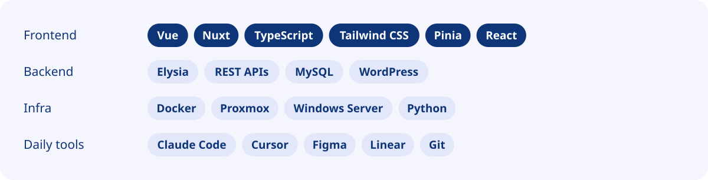

<picture><source media="(prefers-color-scheme: dark)" srcset="./assets/banner-dark.svg"></picture>

  <a href="https://www.linkedin.com/in/nilsgerersdorfer"><picture><source media="(prefers-color-scheme: dark)" srcset="./assets/btn-linkedin-dark.svg"></picture></a>
  <!-- Portfolio button – remove the comment markers once nils.gerersdorfer.com is live
  <a href="https://nils.gerersdorfer.com"><picture><source media="(prefers-color-scheme: dark)" srcset="./assets/btn-portfolio-dark.svg"></picture></a>
  -->

### About

I've been coding every day since I was 14. For two and a half years I worked on a property-management and channel-manager system at my-bookings in Vienna – Vue, Nuxt, TypeScript and Tailwind in the frontend, REST APIs in the backend. I like clean, typed components and talking to the people who actually use what I build.

### Right now

- Open to **frontend & full-stack roles** in Vienna or hybrid
- Building my portfolio with **Nuxt 3** and TypeScript
- Passed my final apprenticeship exam in **software development**

### Things I've built

- **[apartment.at](https://www.apartment.at)** – built with Nuxt
- **Client websites, end to end** – planning, build, feedback rounds and launch, directly with the clients
- **Vue 2 → Vue 3 migration** – built the conversion script that moved our property-management system to Tailwind + Vue 3
- **IT for a family business** – Hyper-V → Proxmox, Windows Server 2016 → 2025, new backup setup

### Stack

<picture><source media="(prefers-color-scheme: dark)" srcset="./assets/stack-dark.svg"></picture>

### Beyond code

Esports crew at Red Bull events: broadcast operator, tournament admin, moderation and interviews.

 

<a href="mailto:ng@gerersdorfer.com"><picture><source media="(prefers-color-scheme: dark)" srcset="./assets/contact-dark.svg"></picture></a>
